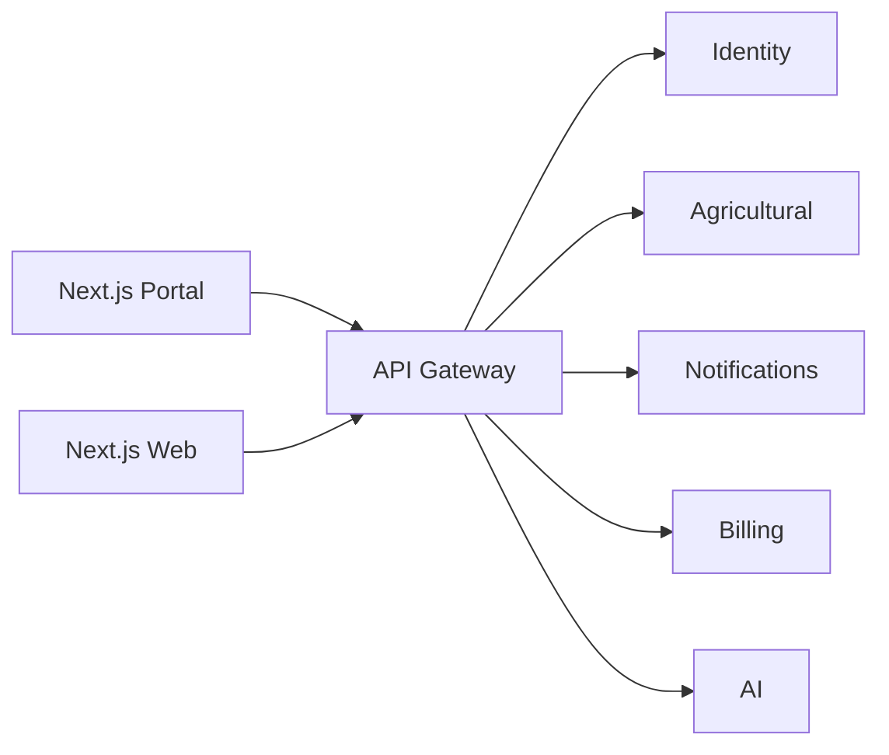

# Arquitectura

## Organización

- **`apps/portal`**: aplicación autenticada de AgroCloud (operaciones agrícolas y superadministración en rutas protegidas).
- **`apps/web`**: web pública, independiente de la sesión del portal.
- **`packages/ui`**: presentación reutilizable sin llamadas a servicios.
- **`packages/api-client`**: transporte y tipos HTTP; reglas de negocio en las aplicaciones o backend.
- **`packages/config`**: TypeScript, estándares y reglas reutilizables.

## Comunicación

La conexión autenticada debe realizarse desde una capa servidor/BFF de Next.js. El navegador nunca debe recibir claves internas, tokens de Cloud Run ni credenciales de IA/Billing. El backend es la autoridad sobre permisos, empresa activa y cupos.

## Módulos del portal

`auth`, `companies`, `users`, `producers`, `lots`, `receptions`, `samplings`, `inspections`, `evidences`, `quality`, `traceability`, `reports`, `notifications`, `subscriptions`.

Usar `features/<módulo>/` para sus pantallas auxiliares, schemas, hooks y servicios. `app/` contiene únicamente las rutas y layouts.

## Estado de implementación

Esta entrega configura el monorepo; no traslada automáticamente las vistas Blade/Livewire del repositorio anterior. Migrar funcionalidad por funcionalidad validando el contrato actual del backend.
